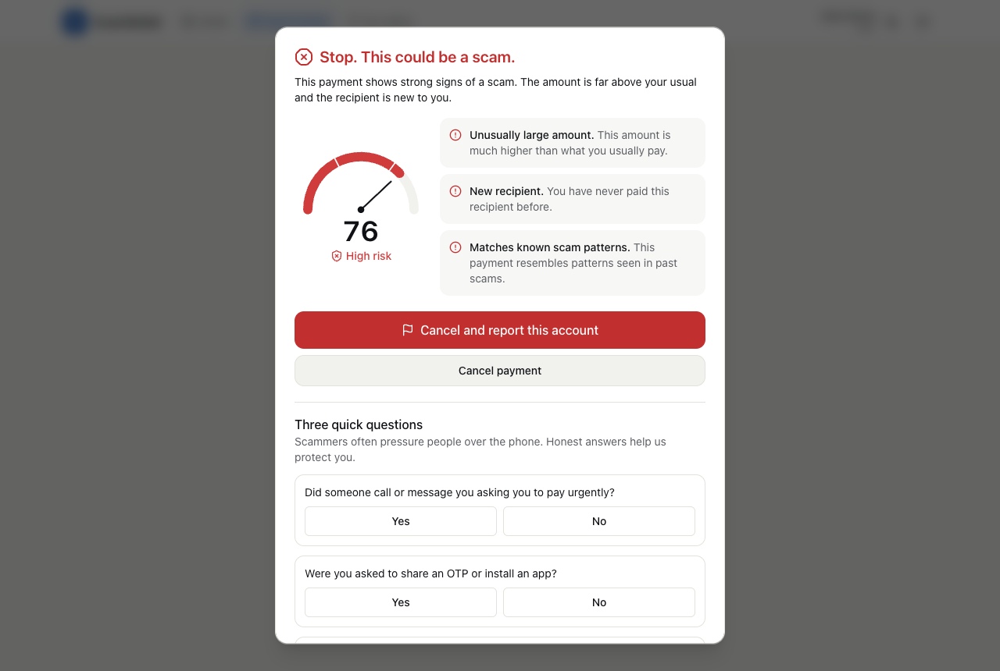
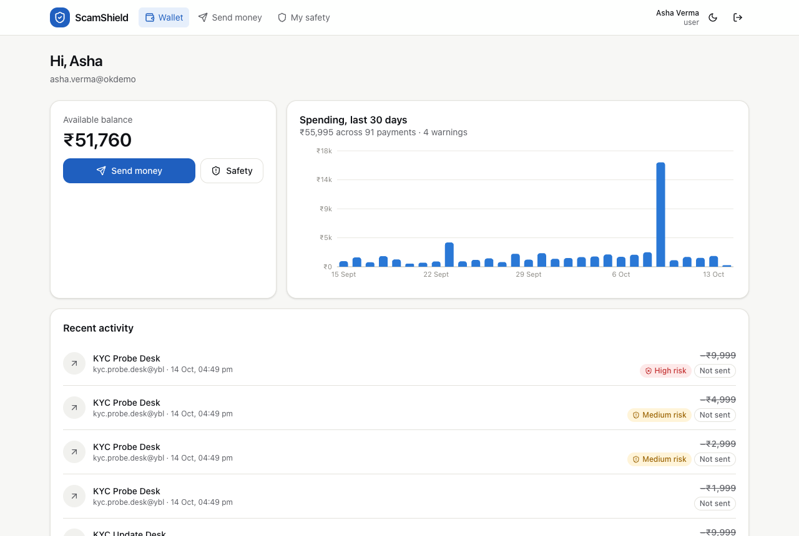
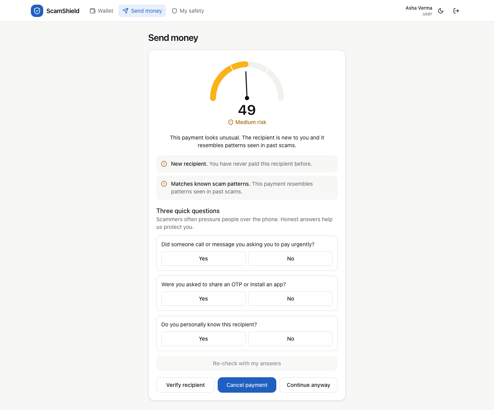
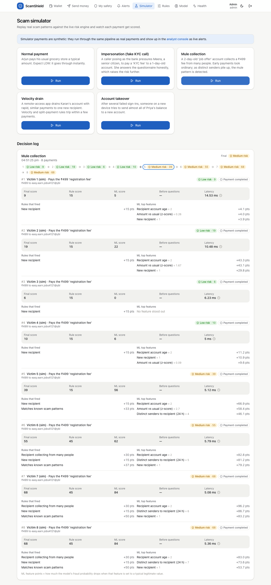
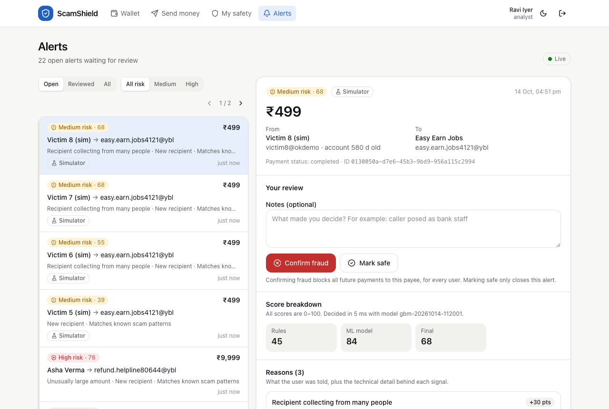
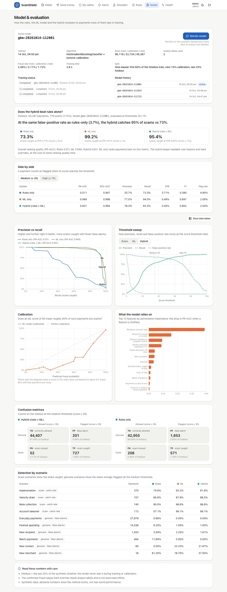
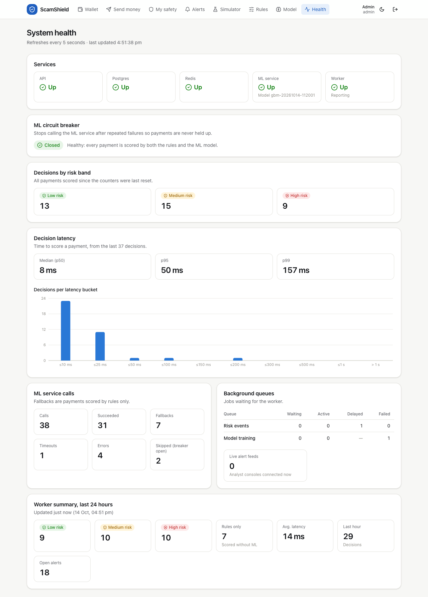
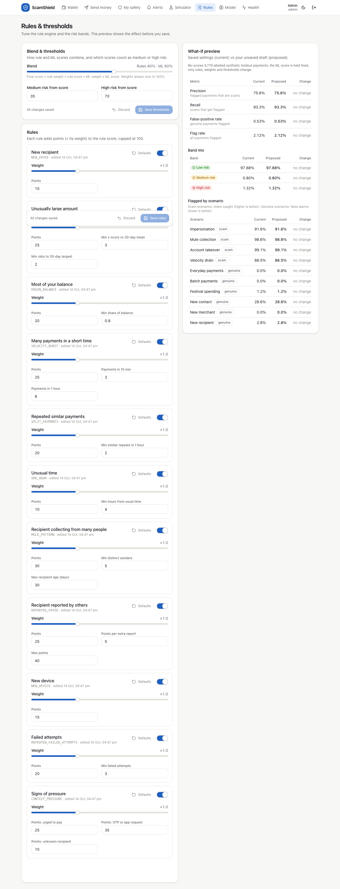
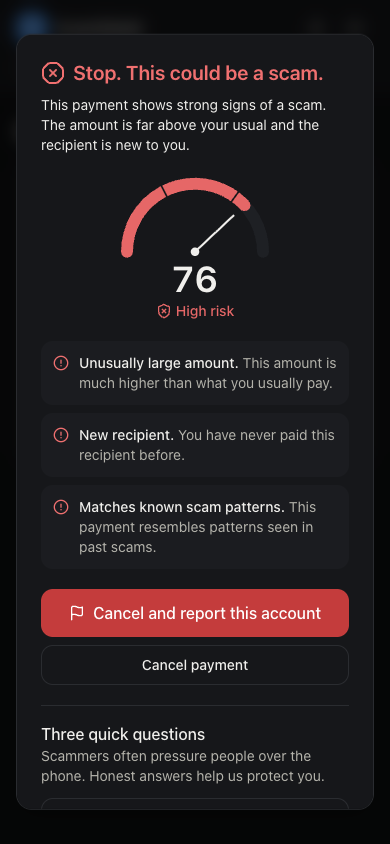
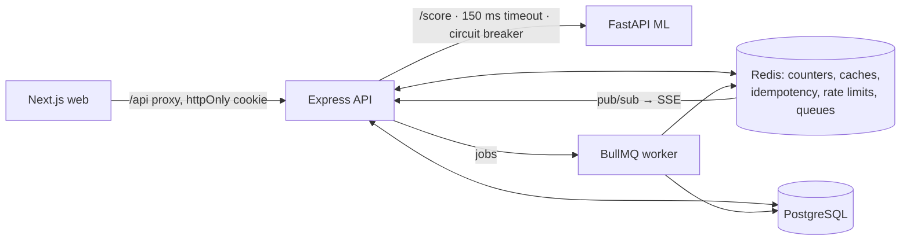

# ScamShield

**Stop the scam before the money moves.**

ScamShield detects payment scams in a UPI-style wallet *before* the payment is authorised. Every payment gets:
- a 0-100 risk score
- a band (LOW / MEDIUM / HIGH)
- plain-language reasons

The app's response matches the risk:

| Band | What the payer sees |
|---|---|
| LOW | Nothing. The payment goes through instantly. |
| MEDIUM | A warning, the top reasons and three quick "scam-context" questions. |
| HIGH | A blocking screen with a 10-second safety pause, and they must retype the recipient's UPI ID. "Cancel and report" is the obvious button. |

Analysts review alerts live and label them FRAUD or SAFE. Those labels feed back into payee reputation, hard overrides and model retraining.

> College mini project. All users, payments and money are **synthetic**. No real bank or payment network is connected.
> ScamShield lowers risk; it does not and cannot guarantee that every scam is caught.



## Quick start

You need Docker Desktop (Compose v2) and `make`. Run one command:

```bash
make demo            # copies .env.example → .env if missing, builds and starts everything, waits until ready
```

Or do the same by hand:

```bash
cp .env.example .env
docker compose up --build
```

**First boot takes 3-6 minutes.** The ML container generates about 165k synthetic transactions, trains and calibrates the model, and evaluates it before it starts serving. The API runs its migrations and loads the demo data on its own. Later starts reuse the trained model and the database.

| What | URL |
|---|---|
| Web app | http://localhost:3000 |
| API docs (Swagger / OpenAPI) | http://localhost:4000/docs |
| API health / readiness | http://localhost:4000/health · http://localhost:4000/ready |
| ML service (model + metrics) | http://localhost:8000/model · http://localhost:8000/docs |

### Demo accounts

All demo accounts use the password `Demo@1234`. The landing page has one-click buttons for the first three.

| Role | Email | Use it for |
|---|---|---|
| User | `asha@demo.scamshield.in` | Wallet, sending money, warnings, My Safety |
| Analyst | `ravi@demo.scamshield.in` | Live alert queue, reviewing alerts |
| Admin | `admin@demo.scamshield.in` | Simulator, rules and thresholds, model and evaluation, system health (also has the analyst pages) |

There are also 12 simulator personas, such as `arjun@sim.scamshield.in` and `victim1@sim.scamshield.in`. The Scam Simulator uses them so that its runs never disturb Asha's account.

**Recipients for the manual demo:**

| Recipient | Expected result |
|---|---|
| `kirana.sharma@okaxis` | Normal |
| `kyc.update.desk@ybl` | A 2-day-old "KYC desk" |
| `olx.seller.deals@ybl` | Reported 3 times |
| `prize.claim.center@paytm` | Analyst-confirmed scam, so the payment is blocked |

The full walkthrough is in [docs/DEMO_SCRIPT.md](docs/DEMO_SCRIPT.md).

### Useful commands

```bash
make ps         # service status
make logs       # follow logs
make test       # all unit/integration tests (Node + Python)
make e2e        # Playwright end-to-end test (needs the stack running)
make loadtest   # autocannon load test of POST /api/payments/check
make train      # regenerate data, retrain and evaluate inside the ML container
make reset      # stop and delete all data volumes (fresh start)
```

To develop locally without Docker for the app code, run `make install`. That installs the Node and Python dependencies and builds the shared package. Then run `npm run dev -w @scamshield/api`, `npm run dev:worker -w @scamshield/api` and `npm run dev -w @scamshield/web` against the Compose Postgres (port 5433) and Redis (port 6380).

## Screenshots

| | |
|---|---|
|  Wallet dashboard |  MEDIUM warning + questionnaire |
|  Scam Simulator (mule run escalating) |  Analyst console |
|  Model & evaluation |  System health |
|  Rules & thresholds with what-if |  HIGH risk on mobile (dark mode) |

Regenerate with `node scripts/screenshots.mjs` while the stack is running.

## Architecture



**How a payment is checked:**
1. `POST /api/payments/check` (idempotent).
2. The feature builder reads Redis and Postgres.
3. The rules engine runs.
4. The calibrated ML model is called.
5. The two scores are blended and the hard overrides applied.
6. The decision is stored, a job is queued, and the response goes back with a short-lived check token.

The money only moves on `POST /api/payments/confirm`, which requires that token. For HIGH it also requires the cooldown and the retyped UPI ID. The debit, the ledger entries and the status change happen in one database transaction, guarded against double spending.

Details, sequence and ER diagrams, Redis keys and TTLs, consistency and security are in [docs/ARCHITECTURE.md](docs/ARCHITECTURE.md). Endpoints are listed in [docs/API.md](docs/API.md).

```
apps/web          Next.js App Router UI (Tailwind, shadcn-style components, Recharts, TanStack Query)
apps/api          Express API + BullMQ worker (Prisma, ioredis, zod, pino, OpenAPI)
services/ml       FastAPI scoring service + data generator, training, evaluation (scikit-learn)
packages/shared   Feature spec, rule definitions, blend logic, reason catalog, zod schemas (used by API, web and ML)
docs              ARCHITECTURE, API, DATA, DEMO_SCRIPT, LOAD_TEST, screenshots
scripts           load test, stack wait script
```

## What makes it special

1. **Hybrid engine.** Rules and a calibrated ML model are blended (0.4 / 0.6 by default). Two hard overrides apply on top: an analyst-confirmed scam payee is always blocked, and "asked for an OTP or to install an app" is always HIGH. Blend weights and band thresholds can be changed at runtime.
2. **Explainable by design.** Every decision carries reason codes. The user sees the top 3 as plain sentences, such as *"This payment looks unusual. The amount is far above your usual and the recipient is new to you."* The analyst sees every reason with its technical detail and the model's top contributing features.
3. **Scam-context questionnaire.** Three yes/no questions become features, and the payment is re-scored on the spot. The answers can only *raise* the score, so they can't be used to talk the system down.
4. **Per-user baseline.** For each user the system tracks the 30-day mean, spread and maximum amount, their usual payment hour, and their known payees and devices. These live in Redis and are refreshed after every payment. Fraud-labelled payments are excluded, so a scam never becomes the user's "normal".
5. **Recipient reputation and mule signal.** Signals include how many distinct people paid the recipient in 24 hours, how old the recipient's account is, and user reports. Analyst FRAUD labels mark the payee as a confirmed scam account.
6. **Evaluation harness.** It compares rules-only, ML-only and hybrid on a time-based holdout using precision, recall, false-positive rate (FPR), PR-AUC, confusion matrices, a calibration curve, a threshold sweep and per-scenario results. All of it is shown in the UI.
7. **Scam Simulator.** One click runs a realistic scenario through the real pipeline: normal, impersonation, mule collection, velocity drain or account takeover.
8. **Resilience.** The ML call has a 150 ms timeout and a circuit breaker shared through Redis. If the model is slow or down, decisions fall back to rules only and are marked `degraded`.

## Evaluation results (synthetic holdout)

These come from the model trained by `make demo`. The data generator, training and evaluation are deterministic (seed 42), so a fresh install reproduces them. The holdout is the last 25% of the timeline, which the model never saw: 45,387 payments, of which 779 (1.72%) are scams.

| System | PR-AUC | Precision @ score ≥ 35 | Recall @ ≥ 35 | FPR @ ≥ 35 |
|---|---|---|---|---|
| Rules only | 0.511 | 25.7% | 73.3% | 3.71% |
| ML only | 0.946 | 72.7% | 94.6% | 0.62% |
| **Hybrid** | 0.933 | **79.1%** | 93.2% | **0.43%** |

- **At the same false-positive rate as rules-only (3.7%)**, the hybrid catches **95.6%** of scams versus **73.3%** for rules alone. The hybrid beats rules-only on recall at a comparable FPR, as required.
- **Honest finding:** ML-only ranks payments slightly better than the hybrid (PR-AUC 0.946 vs 0.933). The rule component costs a little ranking quality. In exchange it provides readable reasons, keeps working when ML is down, and supports hard overrides. The threshold sweep on the Model page shows the trade-off at every threshold.
- **Calibration:** the probabilities are calibrated with isotonic regression on a separate time slice. On the holdout the model is somewhat over-confident in the 30-60% range. The holdout contains a festival period that shifts the data, and the calibration chart shows this rather than hiding it.

While building, the evaluation exposed two synthetic-data leaks, which were fixed rather than reported as wins. First, scam amounts came from a fixed menu like ₹4,999, so the model memorised exact amounts. Second, scammer accounts were all brand-new while legitimate payees were all old. Both were fixed in the generator, and the reasoning is in [docs/DATA.md](docs/DATA.md).

Load test: p95 is about 110 ms for `POST /payments/check` at 20 req/s, against a 300 ms budget, with zero ML fallbacks. See [docs/LOAD_TEST.md](docs/LOAD_TEST.md).

## Tests

| Suite | What it covers |
|---|---|
| `packages/shared` (Vitest) | rules, blend, bands, overrides, reason text, and **300 Node/Python feature + rule parity cases** |
| `apps/api` (Vitest + supertest, real Postgres/Redis, stub ML) | auth and RBAC, the feature builder (velocity, senders, baselines, devices), the two-phase flow, idempotency, concurrent double-spend, token tampering, cooldown and verification, "the questionnaire can only raise the score", blocking, reports, ML fallback, timeout, circuit breaker open → half-open → closed, worker jobs |
| `services/ml` (pytest) | feature parity fixture, rule port, scoring contract and validation, p95 < 50 ms, evaluation shape |
| `apps/web/e2e` (Playwright) | happy path (LOW goes through) and scam path (HIGH, cooldown gate, cancel and report) |

## Defaults and assumptions

These choices were made where the brief left room.

- **Time and money:** the timezone is IST for every hour-of-day feature. The payment limit is ₹1,00,000. New wallets start with ₹25,000 of demo money.
- **Rule points and bands:** each rule has default points, editable on the Rules page. Bands are LOW < 35 ≤ MEDIUM < 70 ≤ HIGH.
- **Extra hard override:** "asked for an OTP or to install an app" forces at least HIGH.
- **Failed attempts:** `failed_attempts_15min` counts failed logins plus failed recipient re-type checks.
- **Recipient age:** `payee_age_days` is the time since the recipient was first seen on the platform, and 0 if never seen.
- **Device binding:** the browser sends a random device id, which the server hashes. The demo accounts are bound to a simulated "registered phone", and the one-click demo login uses it. Typing the same credentials in a new browser therefore counts as a **new device**, which is itself a useful thing to show in the demo.
- **Password hashing:** `bcryptjs` is used instead of native `bcrypt`. It is the same algorithm and avoids native builds in Docker.
- **Model and explanations:** the model is scikit-learn's HistGradientBoosting with isotonic calibration. XGBoost and SHAP were left out to keep the container small. Per-decision explanations instead come from occlusion: each feature is reset to a typical legitimate value and the drop in probability is measured.
- **Analyst labels** are only ever added to *training* data, never to the holdout.
- **The what-if preview** on the Rules page re-scores a labelled sample of the holdout, with the ML score held fixed.
- **The simulator** resets its own personas' Redis state and balances before each run, so runs are repeatable.
- **ML service** runs one uvicorn worker with `OMP_NUM_THREADS=1`. Training status and model reload are held in process memory.

## Known limitations

- **Synthetic data only.** The metrics show that the method works on a realistic simulation; they say nothing about real-world fraud rates. Real scam patterns are more varied and adapt over time.
- **No real bank or payment-network integration.** There is no NPCI, no real UPI and no real money. The ledger is internal.
- **Not production-certified.** There is no penetration test, no PCI or RBI compliance review, no HA deployment and no key rotation, and the secrets are demo defaults.
- **The questionnaire relies on honesty.** A coached victim may answer "no" to every question. Answers can only raise risk, never lower it.
- **Training-time checks:** the confirmed-fraud-payee override and analyst labels are not exercised in offline evaluation, because the synthetic data has no analyst labels.
- **Single-instance setup.** One API, one worker, one ML process. Both the API and ML services are stateless and can scale out (see ARCHITECTURE.md §10), but this was not load-tested beyond about 20 req/s.
- **Reports can be gamed by many fake accounts.** Each account can report a payee only once, but nothing stops someone creating many accounts. Analyst review remains the authority for blocking a payee.
- **Approximate baselines:** the baseline cache refreshes asynchronously, so a burst of payments can be scored against a baseline a few hundred milliseconds old. The velocity counters themselves are updated synchronously.

## Future scope

- A graph model of payee ↔ sender networks to detect mule rings, and device fingerprinting.
- A model registry with shadow deployment and canary rollout, plus drift monitoring.
- A feature store, Kafka-based streaming features, and a Redis Cluster.
- Multi-language reason text: the catalog is already keyed by locale.
- Federated learning across banks, so scam patterns can be shared without sharing customer data.
