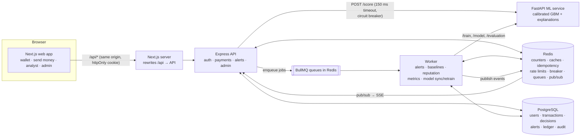
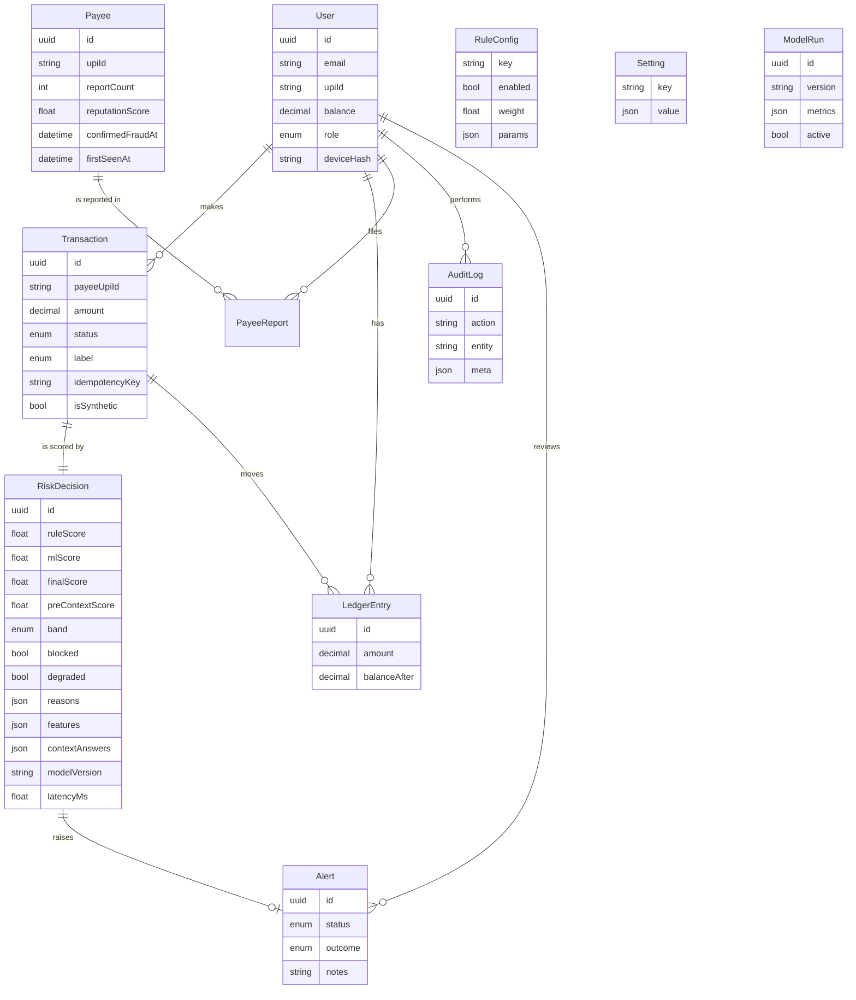

# ScamShield architecture

ScamShield scores a payment **before** money moves. A wallet user starts a payment, the API builds behavioural
features, a hybrid engine (deterministic rules + a calibrated ML model) returns a 0-100 score, a band and plain-language
reasons, and the app intervenes in proportion: nothing for LOW, a warning plus questionnaire for MEDIUM, a blocking
pause-and-verify step for HIGH. Everything here runs on synthetic data.

## 1. Components



| Container | Role |
|---|---|
| `web` | Next.js App Router UI. Proxies `/api/*` to the API so cookies stay same-origin. |
| `api` | Stateless Express API. Runs migrations + idempotent seed on start. |
| `worker` | Same image as the API, runs `worker.js`: everything that must not slow the payer down. |
| `ml` | FastAPI. On first boot generates synthetic data, trains, evaluates, then serves `/score`. |
| `postgres` | System of record. |
| `redis` | Hot state, caches, queues, pub/sub. |

## 2. The payment check (hot path)

```mermaid
sequenceDiagram
  autonumber
  participant U as Payer (web)
  participant A as API
  participant R as Redis
  participant P as Postgres
  participant M as ML service
  participant Q as Queue/Worker
  U->>A: POST /api/payments/check {payee, amount}<br/>Idempotency-Key, X-Device-Id
  A->>R: SET idem:{user}:{key} NX (claim)
  par feature builder
    A->>P: user balance, account age
    A->>R: baseline hash (Postgres on miss), known payees/devices sets,<br/>velocity ZSETs, payee senders ZSET, failures ZSET, payee info cache
  end
  A->>A: computeFeatures() → rules engine
  A->>M: POST /score (timeout 150 ms) — skipped if breaker open
  M-->>A: probability, top features, model version
  A->>A: blend (0.4·rules + 0.6·ML), hard overrides, band, reasons
  A->>P: INSERT transaction (PENDING/BLOCKED) + risk_decision
  A->>Q: enqueue "decision" job
  A->>R: store idempotent response, metrics
  A-->>U: score, band, top-3 reasons, checkToken (10 min)
  Note over U: LOW → auto-confirm · MEDIUM → warning + questionnaire · HIGH → blocking modal
  opt questionnaire
    U->>A: POST /payments/:id/context → re-score (score can only go up)
  end
  U->>A: POST /payments/confirm {checkToken, retypedUpiId?}
  A->>A: verify token; amount/payee match; HIGH: cooldown + retyped UPI
  A->>P: one DB transaction: PENDING→COMPLETED (guarded), guarded debit, ledger entries, payee upsert
  A->>R: velocity, payee senders, known payee/device sets
  A->>Q: enqueue "payment-completed"
  Q-->>R: worker: baseline refresh, reputation, alert + publish SSE event
```

**Latency budget: p95 < 300 ms end-to-end.** The feature builder is one Postgres round trip plus pipelined Redis reads
running in parallel; rules are pure CPU (microseconds); the ML call is capped at 150 ms; the decision write is one
insert. Everything else (alerts, baselines, reputation, live events) is a queued job. Measured numbers are in §9.

### Two-phase payment
`check` never moves money. It returns a short-lived **checkToken** (HS256 JWT signed with `CHECK_TOKEN_SECRET`,
10 min) that binds user, transaction, amount and payee. `confirm` requires it, so a client cannot skip the risk
check, and re-validates the amount and payee against the stored transaction. A HIGH decision additionally needs the
10-second cooldown to have elapsed (`425` otherwise) and the recipient's UPI ID retyped exactly (`422` otherwise, which
also counts as a failed attempt). Confirmed-scam payees are `BLOCKED` at check time and cannot be confirmed at all.

### Idempotency
`Idempotency-Key` on `check` is claimed with `SET NX` in Redis (24 h). A retry with the same key and body replays the
stored response (`Idempotent-Replayed: true`); the same key with a different body is `422`; a duplicate arriving while
the first is in flight is `409`. A unique index on `(userId, idempotencyKey)` is the second line of defence.

## 3. Risk engine

The feature spec (`packages/shared/spec/features.json`) and rule defaults (`spec/rules.json`) are JSON read by **both**
Node and Python. `packages/shared/src/features.ts` and `services/ml/scamshield_ml/features.py` implement the same
computation from the same `FeatureInput`; a parity test runs 300 random inputs through Python, commits the expected
output, and the TypeScript test must reproduce every feature and rule score exactly (JavaScript rounding is mirrored
in Python).

* **20 features** – amount vs the user's 30-day baseline (z-score, ratio to max, ratio to balance), new payee, payee
  age, distinct senders to the payee in 24 h, reports, velocity (10 min / 1 h), similar repeated amounts, hour and
  deviation from the user's usual hour (circular mean), night, account age, new device, failed attempts in 15 min,
  and three questionnaire features (0 until answered).
* **11 rules** – each returns points; `RuleConfig` holds `enabled`, `weight` and params, editable at runtime.
  Rule score = min(100, Σ weight × points).
* **ML** – HistGradientBoosting with balanced class weights, isotonic calibration on a later time slice; the ML score
  is calibrated probability × 100.
* **Blend** – `final = clamp(wR·rule + wM·ml)`, defaults 0.4/0.6; bands LOW < 35 ≤ MEDIUM < 70 ≤ HIGH. All four
  numbers are runtime-editable (`Setting.thresholds`), cached per API process for 5 s.
* **Hard overrides** – analyst-confirmed fraud payee → score ≥ 95, HIGH, blocked. "Asked for an OTP / to install an
  app" → at least HIGH.
* **Reasons** – overrides first, then rule hits by points, then an ML-pattern reason if ML ≥ 50. Users see the top 3
  as plain sentences from the reason catalog (`packages/shared/src/reasons.ts`, keyed by locale for i18n); analysts
  see all of them with technical detail.
* **Questionnaire** – answers become `ctx_*` features and the payment is re-scored. The final score is never lowered
  below the pre-questionnaire score, so the questionnaire cannot be used to talk the system down.
* **Baselines exclude FRAUD-labelled payments**, so a scam never becomes the victim's "normal".

### Resilience
`mlClient.ts` calls `/score` with `AbortSignal.timeout(150)`. A shared Redis circuit breaker counts failures in a
30 s window; at 5 it opens for 15 s (ML skipped), then a single probe request (`SET NX` lock) decides between closing
and re-opening. When ML is unavailable the decision is **rules only** and marked `degraded: true`, shown to the user
("checked with safety rules only") and to analysts, and counted on the System Health page.

## 4. Redis usage

| Key | Type | TTL | Purpose |
|---|---|---|---|
| `vel:{user}` | ZSET (txnId → ts) | 2 h | completed payments for 10-min / 1-h velocity |
| `vel:{user}:{upi}` | ZSET (`txnId:amount` → ts) | 2 h | similar amounts to the same payee (split payments) |
| `payee:{upi}:senders` | ZSET (userId → last ts) | 25 h | distinct senders in 24 h (mule signal) |
| `payee:{upi}:info` | STRING (JSON) | 10 min | payee age, reports, confirmed-fraud; invalidated on change |
| `user:{id}:payees` / `user:{id}:devices` | SET (+ sentinel) | 7 d | known payees / devices, rebuilt from Postgres on miss |
| `user:{id}:profile` | HASH | 24 h | 30-day baseline (count, mean, std, max, hour sin/cos); refreshed by the worker |
| `fail:{id}` | ZSET | 20 min | failed logins / failed verifications |
| `idem:{user}:{key}` | STRING (JSON) | 24 h | idempotent responses |
| `rl:auth:*`, `rl:check:*` | counters | 1 min | rate limits (auth per IP, check per user) |
| `cb:ml:open` / `cb:ml:failures` / `cb:ml:tripped` / `cb:ml:probe` | STRING | 15 s / 30 s / 1 h / 5 s | circuit breaker |
| `metrics:*` | HASH / LIST | – | decision counts, latency histogram + last 2,000 samples, ML outcomes, worker summary (90 s) |
| `cache:holdout-sample` | STRING | 1 h | labelled sample for the rules what-if preview |
| `bull:*` | BullMQ | – | queues `risk-events` and `model` |
| `scamshield:events` | pub/sub | – | live alert events → every API instance → SSE clients |

Velocity and sender counters are written **synchronously** at confirm (cheap, and the next payment must see them);
the baseline is refreshed asynchronously (it needs an aggregate query).

## 5. Async pipeline (BullMQ worker)

| Job | Trigger | Work |
|---|---|---|
| `decision` | every check and re-score | MEDIUM/HIGH → upsert `Alert`, publish live event |
| `payment-completed` | confirm | refresh the payer's baseline hash; recompute payee reputation |
| `payee-updated` | report, analyst verdict | recompute payee reputation, invalidate cache |
| `metrics-aggregate` | every 30 s | 24 h roll-up for System Health (also the worker heartbeat) |
| `model-sync` | start + every 60 s | register the model the ML service serves (with its evaluation) as the active `ModelRun` |
| `model-retrain` | admin button | export analyst labels → ML `/train` → poll → register |

Why off the hot path: none of these change the decision for the current payment, some are slow (aggregate queries,
training), and a queue outage must not block payments (`enqueue` logs instead of throwing). Jobs retry with
exponential backoff.

**Live alerts:** the worker publishes to Redis pub/sub; each API instance relays to its connected analysts over
Server-Sent Events (`GET /api/alerts/stream`, heartbeat every 15 s). This works with any number of API replicas.

## 6. Data model



Indexes: `Transaction(userId, createdAt)`, `(payeeUpiId, createdAt)`, `(status)`, unique `(userId, idempotencyKey)`;
`RiskDecision(band, createdAt)`; `Alert(status, createdAt)`; `LedgerEntry(userId, createdAt)`.

## 7. Consistency

`confirm` runs in one Postgres transaction:
1. `UPDATE transaction SET status='COMPLETED' WHERE id=? AND status='PENDING'` – exactly one concurrent confirm can
   win; the others see 0 rows and get `409`.
2. `UPDATE user SET balance = balance - amt WHERE id=? AND balance >= amt` – the balance can never go negative, even
   with two different pending payments confirmed at once.
3. Ledger debit (and credit if the payee is a platform user) with the resulting balance; payee upsert.

Any failure rolls back all of it. Row-level conditional updates are enough at READ COMMITTED – no explicit locks or
serializable isolation needed. A test fires five concurrent confirms and asserts one success and an exact balance.
Redis side effects happen after commit; if they fail, the worst case is a slightly stale counter, never wrong money.

## 8. Security

* Passwords hashed with bcrypt (cost 10, `bcryptjs` – same algorithm, no native build in Docker).
* Session JWT (HS256, 8 h) in an **httpOnly, SameSite=Lax** cookie (`Secure` configurable for HTTPS); a bearer token
  is also accepted for API clients. Constant-time-ish login for unknown emails; generic error messages.
* RBAC: `USER`, `ANALYST`, `ADMIN` (admin inherits all) enforced server-side on every route; the UI gates are cosmetic.
* Zod validation on every body/query/param; JSON body limit 100 kB; helmet headers; CORS restricted to the web origin.
* Rate limits in Redis: auth 20/min per IP, payment checks 120/min per user.
* Audit log for analyst verdicts, rule/threshold changes, retraining and simulator runs.
* No secrets in the repo (`.env.example` only); device ids are hashed; synthetic data only; no card or bank data.

## 9. Observability and performance

* pino structured logs with a request id (`x-request-id` echoed back); secrets and cookies redacted.
* `/health` (liveness) and `/ready` (Postgres + Redis) on the API; `/health` on ML (includes model version).
* `GET /api/admin/metrics`: decisions per band, latency histogram + p50/p95/p99 over the last 2,000 checks, ML
  calls/fallbacks/timeouts/breaker skips and breaker state, queue depths, service status, live SSE clients, worker
  roll-up. Rendered on the admin **System Health** page.
* Load test: `make loadtest` (autocannon, `scripts/loadtest.mjs`). Results: see [LOAD_TEST.md](LOAD_TEST.md).

## 10. Scaling beyond the demo (not implemented)

* The API is stateless (state lives in Redis/Postgres, SSE fan-out via pub/sub), so it scales horizontally behind a
  load balancer; the ML service scales the same way (one process per core).
* Redis Cluster with hash tags per user (`{user}`) so a user's keys share a slot; Postgres read replicas for lookups
  and partitioning of `Transaction`/`RiskDecision` by month.
* A proper feature store (online Redis + offline warehouse) to guarantee training/serving parity at scale.
* Kafka instead of BullMQ for durable, replayable event streams and stream processing of mule/velocity signals.
* A model registry (e.g. MLflow) with **shadow deployments**: a candidate model scores live traffic without affecting
  decisions until its metrics are proven; canary rollout afterwards.
* Graph analytics for mule rings (payee ↔ sender graph), device fingerprinting, and federated learning across banks
  so fraud patterns are shared without sharing customer data.
